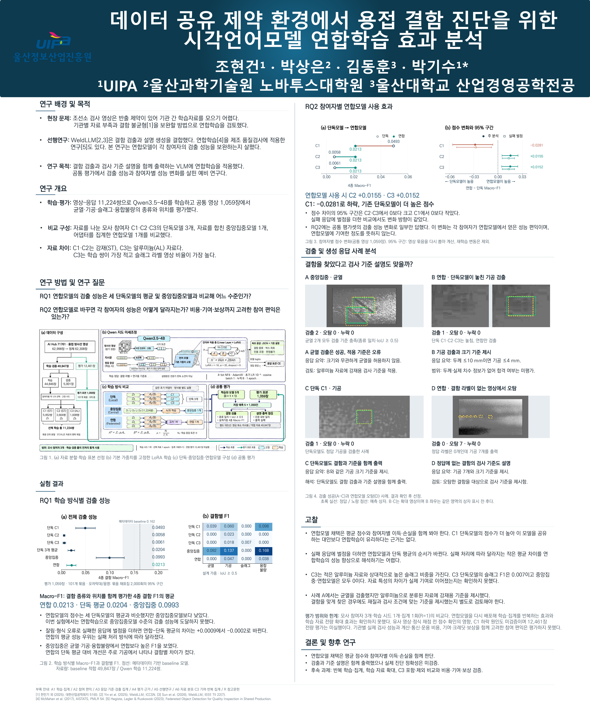

# 데이터 공유 제약 환경에서 용접 결함 진단을 위한 시각언어모델 연합학습 효과 분석

용접 검사 영상을 한곳에 모으기 어려운 상황에서, 참여자들이 따로 학습한 결과를 합쳐 결함 검출 성능을 높일 수 있는지 살핀 예비 연구다. 영상과 글을 함께 처리하는 시각언어모델(VLM)이 방사선 영상에서 **결함의 종류·위치와 검사기준 설명을 함께 출력**하도록 학습했다. 이 저장소에는 연구 코드와 문서를 정리했다.

AI Hub 이용 신청 자료를 세 참여자에게 나눠 모사 실험을 했다. 실제 세 회사가 참여하는 현장 시험은 진행하지 않았다. **연합모델은 단독 성능이 낮던 두 참여자의 모델보다 점수가 높았지만 나머지 한 참여자의 모델과 중앙집중모델보다 낮았다.** 비용·기여·보상까지 고려한 참여 편익은 평가하지 못했다.

## 제출 포스터와 Appendix

- **[제출 포스터 PDF](docs/paper/poster.pdf)** — 연구 질문·방법·결과와 네 사례를 담은 1쪽 포스터.
- **[Appendix PDF](docs/paper/appendix.pdf)** — 참여자별 성능 변화, 검출·오탐·누락, 모델 응답, 학습자료 분포와 후속 검증을 담은 11쪽 보충자료.

아래 미리보기를 누르면 제출 포스터 PDF가 열린다.

## 연구 목적과 질문

연합학습에서는 참여자가 각자의 자료로 모델을 학습한 뒤 학습 결과를 모아 연합모델을 만든다. 이 연구에서는 결함 검출과 기준 설명을 함께 출력하는 모델에 연합학습을 적용했다. 기본 모델의 가중치는 고정하고 추가로 학습한 작은 행렬 묶음(LoRA 어댑터)을 합쳤다.

연구 질문은 두 가지다.

- **RQ1 — 전체 성능:** 연합모델의 검출 성능은 세 단독모델의 평균 및 자료를 한데 모아 학습한 중앙집중모델과 비교해 어느 수준인가?
- **RQ2 — 참여 편익:** 연합모델로 바꾸면 각 참여자의 성능은 어떻게 달라지는가? 계산·통신·운용 비용, 연합모델에 대한 기여와 기여 인정(크레딧)·보상까지 고려한 참여 편익이 있는가?

RQ2에는 공통 평가셋의 검출 성능 변화로 일부만 답했다. 참여자가 연합모델에서 받은 성능 편익을 비교했으며 연합모델에 제공한 기여는 측정하지 못했다. 기관별 실제 검사 성능과 비용·기여·보상을 함께 고려한 참여 편익도 평가하지 못했다.

## 실험 구성

같은 AI Hub 용접 방사선 자료를 C1·C2·C3에 나눠 다섯 모델을 비교했다. C1·C2에는 명목 재질 ST 자료를, C3에는 AL 자료를 배정했다. 실물 재질은 따로 검증하지 않았다.

| 학습 방식 | 자료를 사용하는 방법 | 비교한 모델 수 |
|---|---|---:|
| 단독 | 각 참여자에게 배정한 자료만 학습 | 3 |
| 중앙집중 | 세 참여자의 학습 자료를 합쳐 학습 | 1 |
| 연합 | 참여자별로 학습한 어댑터를 한 차례 집계 | 1 |

기본 모델 **Qwen/Qwen3.5-4B**를 영상·응답 **11,224쌍**으로 학습했다. 참여자별 학습 자료의 약 1/4에 해당하며 다섯 모델을 모두 같은 **1,059장**에서 평가했다. 학습 시드 1개로 선택 자료를 1회 순회하고 연합 집계를 1회 수행했다. 학습·검증 풀에서 계산한 공통 밝기 통계도 사용했다. 따라서 이 실험으로 실제 기관 간 자료 비공유나 개인정보 보호 성능을 검증했다고 보지는 않는다.

C3는 선택 학습자료가 1,608쌍으로 가장 적지만 슬래그 라벨 영상 비율은 11.69%로 가장 높다(C1 0.32%, C2 4.34%). 자료 차이가 실제 성능에 기여했는지는 확인하지 못했다. 전체·선택 학습자료의 결함/정상 및 결함별 분포는 [Appendix A6-1(9쪽)](docs/paper/appendix.pdf#page=9)에 정리했다.

## 주요 결과

주 지표는 균열·기공·슬래그 혼입·융합 불량의 **검출 Macro-F1**이다. 결함의 종류와 위치를 함께 맞혔는지 평가하며 점수가 높을수록 좋다. 영상 단위 정확도나 실제 검사 합격률과는 다른 지표다.

| 모델 | 검출 Macro-F1 |
|---|---:|
| 단독 C1 | 0.0493 |
| 단독 C2 | 0.0058 |
| 단독 C3 | 0.0061 |
| 단독 3개 평균 | 0.0204 |
| 중앙집중 | 0.0993 |
| 연합 | 0.0213 |
| 메타데이터 기반 baseline | 0.1619 |

**RQ1:** 연합모델의 점수는 단독 평균과 비슷했지만 중앙집중모델보다 낮았다. 잘림·형식 오류로 실패한 응답에 벌점을 더하면 연합−단독 평균의 차이가 +0.0009에서 −0.0002로 바뀌었다. 실패 처리 방식에 따라 평균 성능 우위가 뒤집혔다. 중앙집중은 균열·기공·융합 불량에서 연합보다 높았으며 슬래그 혼입은 두 모델 모두 F1이 0이었다.

**RQ2:** 단독모델을 연합모델로 바꿨을 때 점수 차이는 C1 −0.0281, C2 +0.0155, C3 +0.0152였다. 차이의 95% 구간도 C1은 음수, C2·C3는 양수였고 실패 벌점을 더해도 방향은 같았다. 연합모델 채택을 판단할 때는 C1 단독모델을 공유하는 대안의 점수도 함께 고려해야 한다. 이 비교는 같은 공통 평가셋에서 얻은 결과에 한정되며 실제 기관의 운영 이득까지 확인한 것은 아니다.

메타데이터 기반 baseline은 **영상 화소를 보지 않고 영상 ID 구간으로 결함 종류와 대표 위치를 예측하는 대조 모델**이다. 적합 자료는 학습·검증 49,847장으로, Qwen 학습 11,224쌍과 입력 정보·자료량이 모두 다르다. 동일 자료 예산으로 알고리즘을 비교한 것은 아니지만 다섯 학습 모델의 주 지표는 모두 이 대조 모델보다 낮았다.

C3 단독모델의 **슬래그 F1은 0.0068(포스터 표시 0.007)**이고 중앙집중·연합모델은 모두 0이었다. 전체 Macro-F1이나 AL 영상만의 점수와는 다른 값이다. 이 결과만으로 C3의 모든 기여가 0이라고 판단할 수는 없다. C3 포함·제외에 따른 성능 차이를 비교하지 못했기 때문이다.

## 검출과 검사기준 설명

검출과 검사기준 설명은 함께 출력했지만 **실제 진단 정확성은 검증하지 못했다.** 포스터 사례에서는 균열의 종류와 위치를 맞힌 중앙집중모델이 AL 자료에 강재용 기준을 제시했다. 연합모델이 결함 라벨이 없는 영상에 기공을 출력하고 그 기공의 기준을 설명한 사례도 있다.

학습 설명문은 전문가의 판독 소견을 쓰지 않고 결함 라벨과 연구용 기준표로 만들었다. 판 두께와 화소당 실치수가 없어 실제 용접부의 합격·불합격을 판정하는 시스템으로 사용할 수 없다.

## 평가 범위와 한계

- 평가한 1,059장은 전체 평가셋 12,461장의 일부다. 등록된 조건상 전량 평가를 추가해야 했지만 시행하지 않았다. 결과는 평가한 표본에만 해당한다.
- 학습·평가 사이에 유사 영상으로 의심되는 사례가 있고 정식 채점 전에 결과를 확인한 이력도 있다. 유사 영상과 사전 결과 확인이 결과에 미친 영향은 따로 검증하지 못했다.
- 학습 시드 1개·집계 1회(R=1) 결과다. 집계 모델을 다시 배포해 학습·집계를 반복하는 효과와 학습 자료를 전량으로 늘리는 효과는 확인하지 못했다. 95% 구간은 평가 영상 묶음을 다시 뽑아 계산했으며 재학습의 변동은 포함하지 않는다.
- 참여자별 점수 변화의 원인, 기관별 실제 검사 성능, 계산·통신·운용 비용과 기여·크레딧·보상을 함께 고려한 참여 편익은 평가하지 못했다.

연합모델을 채택할 때는 평균점수와 참여자별 이득·손실을 함께 봐야 한다. 현장 도입을 위한 허용 누락·오탐·시간·비용 기준은 이번 결과로 확정하지 않는다.

## 관련 자료

| 알고 싶은 내용 | 자료 |
|---|---|
| 연구 전체 흐름과 검출·설명 사례 | [제출 포스터](docs/paper/poster.pdf) |
| 참여자별 점수 차이·95% 구간 | [제출 포스터 그림 3](docs/paper/poster.pdf) · [구간의 해석: Appendix A4-1(6쪽)](docs/paper/appendix.pdf#page=6) |
| 검출 보완·오탐과 학습 시간·교환량 | [Appendix A2(2쪽)](docs/paper/appendix.pdf#page=2) |
| 실패 처리·모델 응답·검출·오탐·누락 | [Appendix A3(3–5쪽)](docs/paper/appendix.pdf#page=3) |
| 학습자료 분포와 후속 비교 | [Appendix A6(9–10쪽)](docs/paper/appendix.pdf#page=9) |
| 실제 비교 조건과 평가 방법 | [실험 설계](docs/실험설계.md) |
| 실행 당시 설정과 재현에 필요한 자료 | [재현 범위](#재현-범위) |
| 코드를 읽거나 공개 범위에서 시험하기 | [코드 안내](docs/CODE_MAP.md) |
| 데이터 출처·수량·이용 범위 | [데이터 안내](docs/데이터셋_현황.md) · [문서 목차](docs/README.md) |

## 공개 코드와 이용 범위

공개 코드로 학습·집계·평가 구현을 살펴보고 합성 입력을 쓰는 일부 검증을 실행할 수 있다. 제출 포스터와 Appendix에는 연구 사례 영상과 응답 발췌를 실었다. 원본 데이터셋과 영상별 생성 응답 전체, 모델 어댑터, 운영 기록은 공개 자료에 포함하지 않았다. 따라서 저장소를 내려받는 것만으로 위 결과 전체를 재현할 수는 없으며 필요한 자료는 제공처의 이용 조건에 따라 별도로 확보해야 한다.

현재 작업용 `configs/train_registration.yaml`의 학습 비율은 `1.0`이다. 위 결과는 `main-20261102-1`의 약 1/4 학습 조건에 해당하므로 재현할 때는 그 실행에 저장한 설정·분할·어댑터를 사용해야 한다. 등록 파일과 지문에는 당시 실험의 실행 조건을 그대로 남겨 둔다. 현재 문서·주석을 수정해도 이 기록은 바꾸지 않는다.

## 재현 범위

이 README의 결과는 `main-20261102-1` 실행에서 얻었다. 재현하려면 실행 당시 코드와 설정 사본, 초기·최종 어댑터, 동결된 학습·평가 목록, 생성 출력과 채점 산출이 필요하다. 파일의 동일성은 당시 등록 기록으로 확인해야 한다. 현재 파일에 맞춰 과거 해시나 검증 규칙을 바꾸지 않는다. 이 자료 전체를 묶은 실행 패키지는 공개 코드에 포함하지 않았다.

보고한 실행의 학습·생성 설정

| 항목 | 값 |
|---|---|
| 기본 모델 | Qwen/Qwen3.5-4B |
| 모델 revision | `851bf6e806efd8d0a36b00ddf55e13ccb7b8cd0a` |
| LoRA | rank 16, alpha 32, dropout 0.0, bias none |
| 양자화 | 4비트 NF4, double quantization, 계산 dtype bfloat16 |
| AdamW | betas [0.9, 0.999], eps 1e-08, weight decay 0.01 |
| 초기 학습률 / 최종 비율 | 0.0001 / 0.01 |
| 학습률 스케줄 | cosine_global_offset, warmup 0 |
| 미니배치 / 기울기 누적 | 1 / 8 |
| 로컬 순회 / 집계 횟수 | 1 / 1 |
| 손실 정규화 | 감독 토큰 합 기준 |
| LoRA 적용 모듈 | down_proj, gate_proj, in_proj_a, in_proj_b, in_proj_qkv, in_proj_z, k_proj, o_proj, out_proj, q_proj, up_proj, v_proj |
| 채팅 템플릿 | enable_thinking=False |
| 생성 | greedy, beam 1, batch 1, 최대 새 토큰 1280 |
| processor 픽셀 범위 | 65536–16777216 |
| 좌표 | 원본 영상 픽셀 좌표 |

M1은 네 결함의 바운딩박스 F1 매크로 평균이다. IoU 0.5 이상 최대 개수 매칭을 적용하고 주 분석에서는 실패 레코드를 빈 예측으로 읽는다. 민감도 분석은 실패 레코드마다 네 종류에 각각 FP를 추가한다. 소표본 분산 보정 없이 층 안에서 묶음을 복원추출하는 재표집을 2000회 수행했으며 난수 시드는 20260825다. 모델 간 비교에는 같은 재표집을 적용했다. 재표집 세부 선택은 사전에 등록하지 않은 항목으로 결과 파일에 기록돼 있다.

정식 채점 전에 부분 미리 보기와 전체 예행연습 결과를 확인했다. 전량 평가 추가 조건에 해당했으나 시행하지 않았다. 1차와 2차 실행은 학습량 외 조건도 달라 통제된 학습량 비교로 해석하지 않는다. 학습 시드가 하나여서 반복 학습의 변동은 평가하지 못했다.
